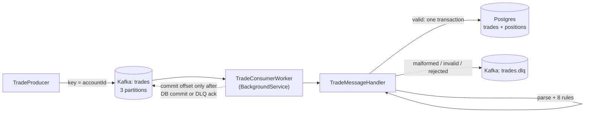
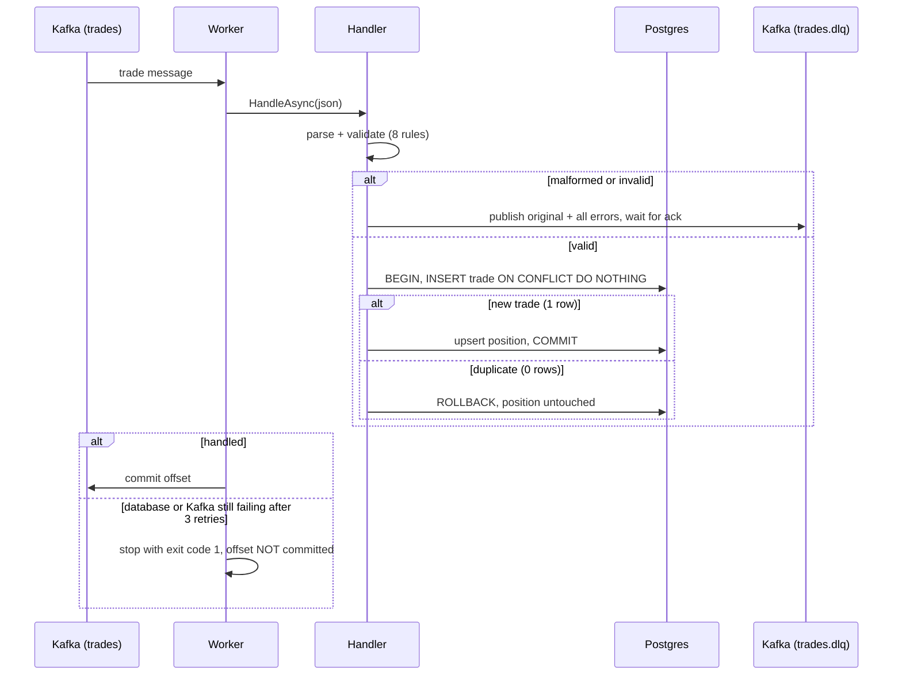
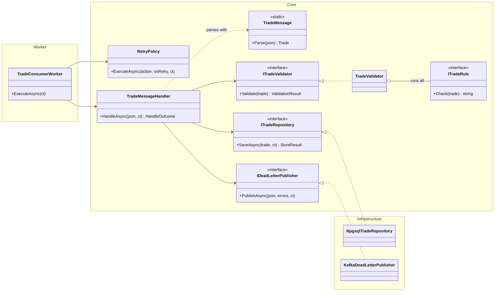

# Trade Event Processor

[](https://github.com/Trungsherlock/trading-event-processor/actions/workflows/ci.yml)

A .NET 10 worker service that consumes trade events from Kafka, validates them, and stores each trade and the account's running position in PostgreSQL. **No trade is lost and no position is counted twice**, even if the worker is killed mid-stream. A crash test checks this end to end.

**Stack:** C# / .NET 10, Apache Kafka 4.3 (KRaft), PostgreSQL 17, ADO.NET via Npgsql (no ORM), xUnit, Testcontainers, GitHub Actions.

## Results

| | |
|---|---|
| Tests | **87** (74 unit, 13 integration against real Kafka and Postgres), run in CI on every push |
| Crash test | Worker force-killed partway through 50,000 messages. After a restart: **46,447 / 46,447** trades and **160 / 160** positions exactly as expected. **308** messages were replayed; 291 were caught as duplicates and 17 bad messages got a second DLQ entry. |
| Throughput | **268 trades/s** with background offset commits (186 with a commit after every message). One durable Postgres transaction per trade, on a laptop (Intel Core Ultra 7 155H, Docker Desktop). |

Details and how each number was measured: [Crash test and throughput](#crash-test-and-throughput).

## How it works



1. The producer keys each message by `accountId`, so each account's trades stay in order within one partition.
2. The handler parses the JSON and runs every validation rule, collecting **all** errors, not just the first.
3. A valid trade is inserted with `ON CONFLICT (trade_id) DO NOTHING`. Only if a row was actually inserted is the account's position updated, in the same transaction.
4. A bad message goes to the dead-letter queue (DLQ) with every error listed, so one poison message can't block its partition.
5. The Kafka offset is committed only after the database commit or the DLQ acknowledgement.

### Message flow



### Classes



`Core` has no Kafka or Postgres dependency, so the domain, validation, parsing, handler and retry logic are unit-tested in milliseconds without Docker. Each validation rule is its own class implementing `ITradeRule`. Adding a rule means adding a class, and the validator doesn't change.

## Delivery guarantees

Kafka transactions only cover Kafka-to-Kafka, so exactly-once isn't available end to end into Postgres. This service uses **at-least-once delivery plus an idempotent write** instead:

- The offset is committed only **after** the trade is stored or the message is in the DLQ. A crash at any point leads to a replay, never a lost trade.
- A replayed trade hits `ON CONFLICT (trade_id) DO NOTHING` and inserts 0 rows, so the position update is skipped. A replay can never double-count a position.

How each failure is handled:

| Failure | What happens | Offset committed? |
|---|---|---|
| Malformed message (bad JSON, missing fields, unknown side, empty message) | Sent to DLQ | Yes |
| Fails validation | Sent to DLQ with **every** error | Yes |
| Duplicate `trade_id` (resend or replay) | Skipped, position untouched | Yes |
| Database rejects the data (e.g. a position would overflow) | Sent to DLQ | Yes |
| Database or Kafka unavailable | 3 retries (200, 400, 800 ms), then the worker stops with exit code 1 | **No**, so the message is redelivered after restart |

A DLQ entry is `{"original": "<raw message>", "errors": [...], "failedAt": "..."}`. The DLQ is at-least-once too, so a replayed bad message can appear in it twice.

## Message format and rules

```json
{
  "tradeId": "8f14e45f-ea2b-4c1a-9b7e-3f0d2a1c5b6e",
  "accountId": "ACC-1001",
  "symbol": "AAPL",
  "side": "BUY",
  "quantity": 100,
  "price": 189.25,
  "executedAt": "2026-11-17T14:30:00Z"
}
```

Quantity and price are `decimal`, never `double`, so values like 0.1 are exact.

| Rule | Check |
|---|---|
| `PositiveQuantityRule` | quantity > 0 |
| `PositivePriceRule` | price > 0 |
| `SymbolFormatRule` | 1–5 uppercase letters |
| `AccountIdRequiredRule` | not empty |
| `TradeIdRequiredRule` | not the empty GUID |
| `NotInFutureRule` | `executedAt` ≤ now (clock injected, so tests control "now") |
| `QuantityPrecisionRule` | fits `NUMERIC(18,4)`: Postgres would otherwise round extra decimals silently or fail the insert |
| `PricePrecisionRule` | fits `NUMERIC(18,6)` |

## Run it locally

Requires the .NET 10 SDK and Docker.

```bash
docker compose up -d                                        # Kafka + Postgres, topics created automatically
dotnet run --project src/TradeProcessor.Worker              # start the worker (leave it running)
dotnet run --project tools/TradeProducer -- 10000           # in a second terminal: send 10,000 trades
dotnet run --project tools/TradeProducer -- verify --wait-seconds 120   # check the database against what was sent
```

The producer sends about 5% invalid messages and 2% resends of earlier trades, and writes the expected results to `expected.json`. `verify` compares the trade count, every position and the new DLQ entries against that file. It prints PASS or FAIL and exits with 0 or 1. It expects a fresh database, so reset between runs with `docker compose down -v` and then `docker compose up -d`.

Postgres is exposed on host port **5433**, not 5432, to avoid clashing with a local install. Connect with `docker compose exec postgres psql -U trades`.

## Tests

```bash
dotnet test        # needs Docker for the integration tests
```

| Suite | Count | What it proves |
|---|---|---|
| Unit (no Docker) | 74 | Each validation rule, including edge cases; parsing of every kind of broken message; the handler sends each kind of failure to the right place; retry timing and give-up behaviour |
| Repository (real Postgres) | 6 | A trade saved twice is counted once; 8 simultaneous saves of one trade insert exactly one row; a failed position update rolls back the trade insert; exact decimal and timestamp round-trips |
| End-to-end worker (real Kafka + Postgres) | 5 | A mixed stream ends with exactly the expected trades, positions and DLQ entries (both commit modes); replaying the whole topic changes nothing; a message that keeps failing is never committed and is stored after a restart (both commit modes) |
| DI wiring | 2 | Every service can be constructed; every rule class in `Core` is registered exactly once |

The containers start once per test run, and tables are emptied before each test. Two bugs were introduced on purpose to confirm the end-to-end and DI tests catch them: committing the offset before handling, and dropping a rule's registration.

## Crash test and throughput

**Crash test.** With the worker running, 50,000 messages were sent (5% invalid, 2% duplicates). The worker was force-killed after about 15,000 trades, the same as `kill -9`. It was then restarted, and `TradeProducer verify` was run.

| Check | Result |
|---|---|
| Rows in `trades` | 46,447 expected, 46,447 actual |
| Positions | 160 / 160 exact |
| Messages replayed after the kill | 308: 291 caught as duplicates, 17 extra DLQ entries |
| Time until processing resumed | 44 s (the broker waits out the dead consumer's 45 s session timeout) |

**Throughput.** 100,000 valid trades were loaded first, then the worker was started (Release build). The rate is measured inside the database, from the first to the last `received_at`. Single run on an Intel Core Ultra 7 155H laptop, with Kafka and Postgres in Docker Desktop (WSL2).

| Commit mode | Rate |
|---|---|
| Commit after every message | 186 msg/s |
| **Background commit (default)** | **268 msg/s** |
| Diagnostic only: Postgres not waiting for the disk | 602 msg/s |

The diagnostic run shows the limit is the durable Postgres commit for each trade (~2.1 ms of ~3.7 ms per message), not Kafka. Turning that off would let Postgres lose a trade whose offset was already committed, so it isn't an option. The next step would be committing trades in batches.

## Design decisions

Each choice below was made by comparing alternatives. The comparisons, tradeoffs and measurements are in [WORKLOG.md](WORKLOG.md).

- **Idempotent sink instead of exactly-once:** the standard approach for Kafka into a database.
- **Plain ADO.NET instead of an ORM:** full control over `ON CONFLICT` and the transaction boundary.
- **Background offset commits:** 1.4× faster, still at-least-once. Selected with the `Kafka:CommitMode` setting.
- **Permanent and temporary failures are separated:** permanent ones go to the DLQ, temporary ones are retried and then stop the worker. Retrying a permanent failure forever would block the partition.
- **Topics created by an init container with auto-create off:** a typo can't silently create a 1-partition topic.

## Known limitations

- One database transaction per trade limits throughput (see above). Batching would raise it.
- After a crash, processing resumes only after Kafka's 45 s session timeout. Static group membership would fix this for long-running instances.
- Not covered by automated tests: Kafka broker outages, rebalances between several workers, long-running soak tests, and the DLQ publisher on its own.
- Throughput numbers are single runs on one laptop.

## Project layout

```
src/
  TradeProcessor.Core/            domain, validation rules, parsing, handler, retry (no Kafka/Postgres)
  TradeProcessor.Infrastructure/  Npgsql repository, Kafka DLQ publisher
  TradeProcessor.Worker/          host, DI wiring, Kafka consumer loop
tests/
  TradeProcessor.UnitTests/         xUnit, no Docker
  TradeProcessor.IntegrationTests/  xUnit + Testcontainers (Postgres, Kafka)
tools/TradeProducer/              test-data producer and verify command
db/init.sql                       schema
docker-compose.yml                local Kafka + Postgres
.github/workflows/ci.yml          build + all tests on every push
```
