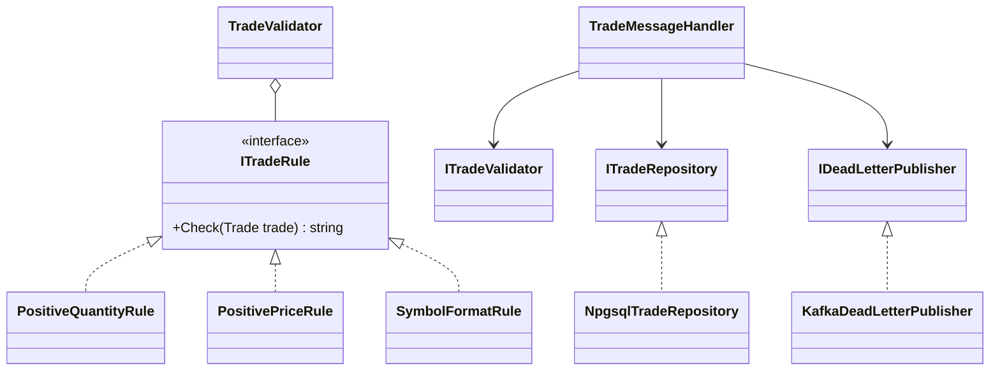
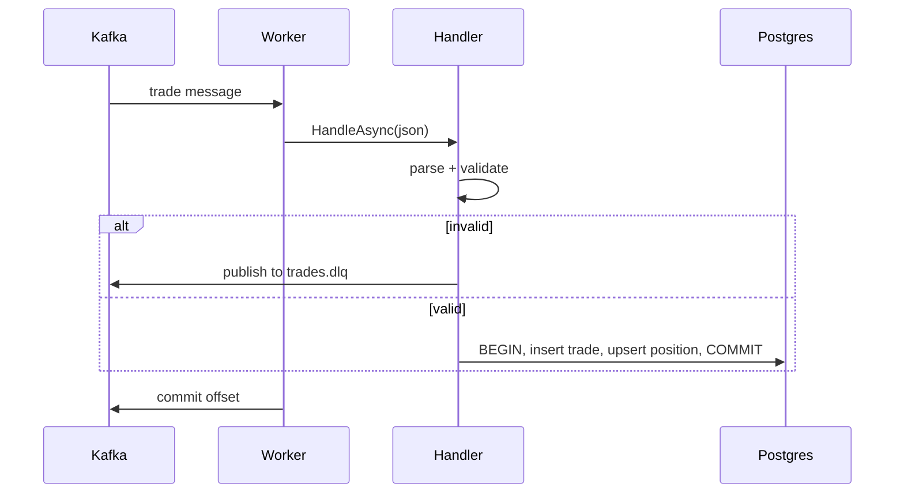

# Trade Event Processor — Build Plan

**Stack:** C#, .NET 10, Kafka, ADO.NET (Npgsql), PostgreSQL, xUnit, Testcontainers, GitHub Actions, Mermaid UML
**Estimated effort:** 2 days, ~14 hours

---

## Decisions before you start

1. **Target .NET 10, not .NET 8.** .NET 8 and .NET 9 reached end of support on November 10, 2026. .NET 10 is the current LTS release, supported through November 2028. The C# is the same: target `net10.0` and put ".NET 10" on the resume.
2. **Measure real numbers.** The resume bullets need metrics. Phase 6 measures throughput, and CI reports the test count. Don't make up numbers.
3. **No ORM.** Use Npgsql directly (`NpgsqlConnection`, `NpgsqlCommand`, `NpgsqlDataReader`); that is ADO.NET. Adding Dapper or EF Core makes the "ADO.NET" claim false.

---

## The core idea

**At-least-once delivery plus an idempotent write, so no trade is lost and no position is counted twice.**

If the worker crashes after the DB commit but before the Kafka offset commit, Kafka sends the same message again. The insert hits `ON CONFLICT (trade_id) DO NOTHING` and returns 0 rows, so the position update is skipped. The rest of this plan supports this.

## Architecture

```
TradeProducer tool ──► Kafka topic "trades" (key = accountId, 3 partitions)
                              │
                   TradeConsumerWorker (BackgroundService)
                              │ raw JSON
                   TradeMessageHandler
                    ├─ parse JSON → Trade (domain object)
                    ├─ TradeValidator (list of ITradeRule)
                    │     bad JSON / invalid ──► "trades.dlq" topic
                    └─ NpgsqlTradeRepository (ADO.NET, one transaction)
                          insert trade ON CONFLICT DO NOTHING + update positions
                              │
                   commit Kafka offset ONLY after the DB commit or the DLQ publish
```

## Repo layout

```
trade-event-processor/
├─ src/
│  ├─ TradeProcessor.Core/             # Trade, rules, validator, handler, interfaces (no NuGet deps)
│  ├─ TradeProcessor.Infrastructure/   # Npgsql repository, Kafka DLQ publisher
│  └─ TradeProcessor.Worker/           # Host, DI, consumer BackgroundService, appsettings.json
├─ tests/
│  ├─ TradeProcessor.UnitTests/        # xUnit + hand-written fakes, no Docker
│  └─ TradeProcessor.IntegrationTests/ # xUnit + Testcontainers (real Postgres)
├─ tools/TradeProducer/                # console app that publishes fake trades
├─ db/init.sql
├─ docker-compose.yml
├─ .github/workflows/ci.yml
└─ README.md                           # Mermaid UML, how to run, results
```

**Why Core is separate:** it doesn't depend on Kafka or Postgres. Most tests then run in milliseconds without Docker, which is what makes test-first practical.

---

## Progress checklist

- [ ] Phase 0: Setup (1 h)
- [ ] Phase 1: Just enough C# (2–3 h)
- [ ] Phase 2: Docker Compose + schema (1 h)
- [ ] Phase 3: Domain + validation, test-first (2–3 h)
- [ ] Phase 4: ADO.NET repository + integration tests (3 h)
- [ ] Phase 5: Handler + Kafka consumer (2–3 h)
- [ ] Phase 6: Producer, crash test, throughput (1 h)
- [ ] Phase 7: GitHub Actions (30 min)
- [ ] Phase 8: UML + README (30–60 min)

---

## Phase 0: Setup (1 h)

```bash
dotnet --version            # should be 10.x
mkdir trade-event-processor && cd trade-event-processor && git init
dotnet new sln -n TradeProcessor
dotnet new classlib -n TradeProcessor.Core             -o src/TradeProcessor.Core
dotnet new classlib -n TradeProcessor.Infrastructure   -o src/TradeProcessor.Infrastructure
dotnet new worker   -n TradeProcessor.Worker           -o src/TradeProcessor.Worker
dotnet new xunit    -n TradeProcessor.UnitTests        -o tests/TradeProcessor.UnitTests
dotnet new xunit    -n TradeProcessor.IntegrationTests -o tests/TradeProcessor.IntegrationTests
dotnet new console  -n TradeProducer                   -o tools/TradeProducer
dotnet sln add src/*/*.csproj tests/*/*.csproj tools/*/*.csproj

# project references
dotnet add src/TradeProcessor.Infrastructure reference src/TradeProcessor.Core
dotnet add src/TradeProcessor.Worker reference src/TradeProcessor.Core src/TradeProcessor.Infrastructure
dotnet add tests/TradeProcessor.UnitTests reference src/TradeProcessor.Core
dotnet add tests/TradeProcessor.IntegrationTests reference src/TradeProcessor.Infrastructure

# packages
dotnet add src/TradeProcessor.Infrastructure package Npgsql
dotnet add src/TradeProcessor.Infrastructure package Confluent.Kafka
dotnet add tools/TradeProducer package Confluent.Kafka
dotnet add tests/TradeProcessor.IntegrationTests package Testcontainers.PostgreSql
```

`dotnet add package` installs the latest version (Confluent.Kafka is 2.16.0 as of Nov 2026).

**Done when:** `dotnet build` and `dotnet test` pass on the empty templates. Commit.

---

## Phase 1: Just enough C# (2–3 h)

Learn only what this project uses, mapped to things you already know:

| C# | What you know | Where you use it |
|---|---|---|
| `record` + `with` | TS readonly object + spread | `Trade`, test builders |
| `interface` / implements | Same as Java | `ITradeRule`, `ITradeRepository` |
| `async Task<T>` / `await` | `async` / `Promise<T>` | DB and Kafka calls |
| `CancellationToken` | `AbortSignal` | Clean shutdown |
| `await using` | try/finally `close()` | Connections, commands, transactions |
| `decimal` | (nothing in JS) | **Money. Never use `double` for price.** |
| `builder.Services.Add…` | NestJS/Spring DI | Wiring things together |
| `string?` (nullable refs) | TS strict null checks | On by default |

You can skip LINQ in depth, reflection and generics variance. Read the `Program.cs` and `Worker.cs` that the worker template generated, because that's the hosting model you'll use.

---

## Phase 2: Docker Compose + schema (1 h)

### docker-compose.yml

```yaml
services:
  kafka:
    image: apache/kafka:latest      # single-node KRaft broker on localhost:9092; pin a tag once it works
    ports: ["9092:9092"]
  postgres:
    image: postgres:17
    environment:
      POSTGRES_USER: trades
      POSTGRES_PASSWORD: trades
      POSTGRES_DB: trades
    ports: ["5432:5432"]
    volumes:
      - ./db/init.sql:/docker-entrypoint-initdb.d/init.sql
```

### db/init.sql

```sql
CREATE TABLE trades (
  trade_id    UUID PRIMARY KEY,                -- the idempotency key
  account_id  TEXT NOT NULL,
  symbol      TEXT NOT NULL,
  side        TEXT NOT NULL CHECK (side IN ('BUY','SELL')),
  quantity    NUMERIC(18,4) NOT NULL CHECK (quantity > 0),
  price       NUMERIC(18,6) NOT NULL CHECK (price > 0),
  executed_at TIMESTAMPTZ NOT NULL,
  received_at TIMESTAMPTZ NOT NULL DEFAULT now()
);

CREATE TABLE positions (
  account_id   TEXT NOT NULL,
  symbol       TEXT NOT NULL,
  net_quantity NUMERIC(18,4) NOT NULL,
  updated_at   TIMESTAMPTZ NOT NULL DEFAULT now(),
  PRIMARY KEY (account_id, symbol)
);
```

### Create the topics

Create the topics yourself instead of relying on auto-create, so you control the partition count:

```bash
docker compose up -d
docker compose exec kafka /opt/kafka/bin/kafka-topics.sh --bootstrap-server localhost:9092 \
  --create --topic trades --partitions 3
docker compose exec kafka /opt/kafka/bin/kafka-topics.sh --bootstrap-server localhost:9092 \
  --create --topic trades.dlq --partitions 1
```

**Done when:** `psql` shows both tables and `kafka-topics.sh --list` shows both topics.

---

## Phase 3: Domain + validation, test-first (2–3 h)

### Message format (put this in the README)

```json
{
  "tradeId": "8f14e45f-ea2b-4c1a-9b7e-3f0d2a1c5b6e",
  "accountId": "ACC-1001",
  "symbol": "AAPL",
  "side": "BUY",
  "quantity": 100,
  "price": 189.25,
  "executedAt": "2026-11-17T14:30:00Z"
}
```

### Rules (one class each)

| Rule | Check |
|---|---|
| `PositiveQuantityRule` | quantity > 0 |
| `PositivePriceRule` | price > 0 |
| `SymbolFormatRule` | 1–5 uppercase letters |
| `AccountIdRequiredRule` | not empty |
| `TradeIdRequiredRule` | not `Guid.Empty` |
| `NotInFutureRule` | executedAt ≤ now (inject `TimeProvider` so tests control what "now" is) |

### TDD loop for each rule

1. Write a failing test, then run it: **red**.
2. Write the least code that passes: **green**.
3. Refactor.
4. Commit the test and the code **separately** (`test: quantity must be positive`, then `feat: PositiveQuantityRule`). If someone asks whether you really worked test-first, the git history shows it.

### Example: the test, written first

```csharp
public class PositiveQuantityRuleTests
{
    [Theory]
    [InlineData(0)]
    [InlineData(-5)]
    public void Rejects_non_positive_quantity(int qty)   // attributes can't take decimal, so use int
    {
        var trade = TradeBuilder.Valid() with { Quantity = qty };
        Assert.NotNull(new PositiveQuantityRule().Check(trade));
    }

    [Fact]
    public void Accepts_positive_quantity() =>
        Assert.Null(new PositiveQuantityRule().Check(TradeBuilder.Valid()));
}

public static class TradeBuilder
{
    public static Trade Valid() => new(Guid.NewGuid(), "ACC-1001", "AAPL", TradeSide.Buy,
        100m, 189.25m, DateTimeOffset.Parse("2026-11-17T14:30:00Z"));
}
```

### Then the code

```csharp
public enum TradeSide { Buy, Sell }

public sealed record Trade(Guid TradeId, string AccountId, string Symbol, TradeSide Side,
    decimal Quantity, decimal Price, DateTimeOffset ExecutedAt)
{
    public decimal SignedQuantity => Side == TradeSide.Buy ? Quantity : -Quantity;
}

public interface ITradeRule { string? Check(Trade trade); }   // null = passed, otherwise the error

public sealed class PositiveQuantityRule : ITradeRule
{
    public string? Check(Trade t) => t.Quantity > 0 ? null : "Quantity must be positive";
}

public sealed record ValidationResult(IReadOnlyList<string> Errors)
{
    public bool IsValid => Errors.Count == 0;
}

public interface ITradeValidator { ValidationResult Validate(Trade trade); }

public sealed class TradeValidator(IEnumerable<ITradeRule> rules) : ITradeValidator
{
    public ValidationResult Validate(Trade t) =>
        new(rules.Select(r => r.Check(t)).OfType<string>().ToList());   // collects ALL errors
}
```

### How to explain the design in an interview

- **Open/closed principle:** a new rule is a new class, and the validator doesn't change.
- Each rule is tested on its own.
- The validator collects **every** error, so the DLQ message lists everything that was wrong, not just the first problem.

**Done when:** about 15–20 unit tests pass, with no Kafka or DB involved.

---

## Phase 4: ADO.NET repository + integration tests (3 h)

### Interface (Core)

```csharp
public enum StoreResult { Inserted, Duplicate }

public interface ITradeRepository
{
    Task<StoreResult> SaveAsync(Trade trade, CancellationToken ct);
}
```

### Implementation (Infrastructure)

```csharp
public sealed class NpgsqlTradeRepository(NpgsqlDataSource db) : ITradeRepository
{
    public async Task<StoreResult> SaveAsync(Trade t, CancellationToken ct)
    {
        await using var conn = await db.OpenConnectionAsync(ct);
        await using var tx = await conn.BeginTransactionAsync(ct);

        await using var insert = new NpgsqlCommand("""
            INSERT INTO trades (trade_id, account_id, symbol, side, quantity, price, executed_at)
            VALUES (@id, @acc, @sym, @side, @qty, @price, @at)
            ON CONFLICT (trade_id) DO NOTHING
            """, conn, tx);
        insert.Parameters.AddWithValue("id", t.TradeId);
        insert.Parameters.AddWithValue("acc", t.AccountId);
        insert.Parameters.AddWithValue("sym", t.Symbol);
        insert.Parameters.AddWithValue("side", t.Side == TradeSide.Buy ? "BUY" : "SELL");
        insert.Parameters.AddWithValue("qty", t.Quantity);
        insert.Parameters.AddWithValue("price", t.Price);
        insert.Parameters.AddWithValue("at", t.ExecutedAt.ToUniversalTime()); // Npgsql rejects non-UTC offsets for timestamptz

        if (await insert.ExecuteNonQueryAsync(ct) == 0)
        {
            await tx.RollbackAsync(ct);
            return StoreResult.Duplicate;     // replayed message: don't touch positions
        }

        await using var upsert = new NpgsqlCommand("""
            INSERT INTO positions (account_id, symbol, net_quantity) VALUES (@acc, @sym, @delta)
            ON CONFLICT (account_id, symbol) DO UPDATE
            SET net_quantity = positions.net_quantity + EXCLUDED.net_quantity,
                updated_at   = now()
            """, conn, tx);
        upsert.Parameters.AddWithValue("acc", t.AccountId);
        upsert.Parameters.AddWithValue("sym", t.Symbol);
        upsert.Parameters.AddWithValue("delta", t.SignedQuantity);
        await upsert.ExecuteNonQueryAsync(ct);

        await tx.CommitAsync(ct);
        return StoreResult.Inserted;
    }
}
```

Always use parameters and never build SQL with string interpolation. Expect to be asked about SQL injection.

### Integration test against real Postgres

This test proves the most important claim in the project:

```csharp
public class NpgsqlTradeRepositoryTests : IAsyncLifetime
{
    private readonly PostgreSqlContainer _pg =
        new PostgreSqlBuilder().WithImage("postgres:17").Build();
    private NpgsqlDataSource _db = null!;

    public async Task InitializeAsync()
    {
        await _pg.StartAsync();
        _db = NpgsqlDataSource.Create(_pg.GetConnectionString());
        await using var cmd = _db.CreateCommand(await File.ReadAllTextAsync("init.sql"));
        await cmd.ExecuteNonQueryAsync();
    }

    public async Task DisposeAsync() => await _pg.DisposeAsync();

    [Fact]
    public async Task Same_trade_twice_counts_position_once()
    {
        var repo = new NpgsqlTradeRepository(_db);
        var trade = TradeBuilder.Valid();

        Assert.Equal(StoreResult.Inserted,  await repo.SaveAsync(trade, default));
        Assert.Equal(StoreResult.Duplicate, await repo.SaveAsync(trade, default));

        await using var q = _db.CreateCommand(
            "SELECT net_quantity FROM positions WHERE account_id='ACC-1001' AND symbol='AAPL'");
        Assert.Equal(100m, (decimal)(await q.ExecuteScalarAsync())!);
    }
}
```

### Practical notes

- Copy `init.sql` into the test output folder. Add this to the IntegrationTests `.csproj`:
  ```xml
  <ItemGroup>
    <None Include="../../db/init.sql" CopyToOutputDirectory="PreserveNewest" />
  </ItemGroup>
  ```
- `TradeBuilder` is needed in both test projects. Copy it over, or move it into a small shared test project.
- If your template turns out to be xUnit v3, `InitializeAsync` and `DisposeAsync` return `ValueTask` instead of `Task`.

**Done when:** the duplicate test passes against real Postgres.

---

## Phase 5: Handler + Kafka consumer (2–3 h)

### Handler (Core: no Kafka types, so you can unit test it with fakes)

```csharp
public enum HandleOutcome { Stored, Duplicate, DeadLettered }

public interface IDeadLetterPublisher
{
    Task PublishAsync(string originalJson, IReadOnlyList<string> errors, CancellationToken ct);
}

public sealed class TradeMessageHandler(ITradeValidator validator, ITradeRepository repo,
    IDeadLetterPublisher dlq)
{
    public async Task<HandleOutcome> HandleAsync(string json, CancellationToken ct)
    {
        Trade trade;
        try { trade = TradeMessage.Parse(json); }     // System.Text.Json DTO → domain Trade
        catch (Exception ex) when (ex is JsonException or FormatException)
        {
            await dlq.PublishAsync(json, [$"Malformed: {ex.Message}"], ct);
            return HandleOutcome.DeadLettered;
        }

        var result = validator.Validate(trade);
        if (!result.IsValid)
        {
            await dlq.PublishAsync(json, result.Errors, ct);
            return HandleOutcome.DeadLettered;
        }

        // DB exceptions are NOT caught here → the offset isn't committed → Kafka redelivers
        return await repo.SaveAsync(trade, ct) == StoreResult.Inserted
            ? HandleOutcome.Stored
            : HandleOutcome.Duplicate;
    }
}
```

### How each failure is handled

| Failure | What happens | Commit offset? |
|---|---|---|
| Malformed JSON | Send to DLQ | Yes |
| Fails validation | Send to DLQ with all errors | Yes |
| Duplicate trade_id | Skip and log | Yes |
| DB down or timeout | Retry 3× with backoff, then crash | **No.** It's redelivered after restart. |

### Handler unit test with fakes

```csharp
public sealed class FakeTradeRepository : ITradeRepository
{
    public List<Trade> Saved { get; } = [];
    public Task<StoreResult> SaveAsync(Trade t, CancellationToken ct)
    {
        if (Saved.Any(s => s.TradeId == t.TradeId)) return Task.FromResult(StoreResult.Duplicate);
        Saved.Add(t);
        return Task.FromResult(StoreResult.Inserted);
    }
}

public sealed class FakeDeadLetterPublisher : IDeadLetterPublisher
{
    public List<(string Json, IReadOnlyList<string> Errors)> Published { get; } = [];
    public Task PublishAsync(string json, IReadOnlyList<string> errors, CancellationToken ct)
    {
        Published.Add((json, errors));
        return Task.CompletedTask;
    }
}

[Fact]
public async Task Invalid_trade_goes_to_dlq_and_is_not_stored()
{
    var repo = new FakeTradeRepository();
    var dlq  = new FakeDeadLetterPublisher();
    var handler = new TradeMessageHandler(
        new TradeValidator([new PositiveQuantityRule()]), repo, dlq);

    var json = """
        {"tradeId":"8f14e45f-ea2b-4c1a-9b7e-3f0d2a1c5b6e","accountId":"ACC-1","symbol":"AAPL",
         "side":"BUY","quantity":-5,"price":10,"executedAt":"2026-11-17T14:30:00Z"}
        """;

    Assert.Equal(HandleOutcome.DeadLettered, await handler.HandleAsync(json, default));
    Assert.Empty(repo.Saved);
    Assert.Single(dlq.Published);
}
```

More handler tests to write: malformed JSON goes to the DLQ, a valid trade is stored, the same trade sent twice returns `Duplicate`, and an exception from the repository propagates instead of being swallowed.

### Consumer worker (Worker project)

```csharp
public sealed class TradeConsumerWorker(TradeMessageHandler handler, IOptions<KafkaOptions> opt,
    ILogger<TradeConsumerWorker> log) : BackgroundService
{
    // Consume() blocks a thread, so Task.Run keeps it from blocking host startup
    protected override Task ExecuteAsync(CancellationToken ct) => Task.Run(() => RunAsync(ct), ct);

    private async Task RunAsync(CancellationToken ct)
    {
        var config = new ConsumerConfig
        {
            BootstrapServers = opt.Value.BootstrapServers,
            GroupId = "trade-processor",
            EnableAutoCommit = false,                 // we decide when a message is done
            AutoOffsetReset = AutoOffsetReset.Earliest,
        };

        using var consumer = new ConsumerBuilder<string, string>(config).Build();
        consumer.Subscribe("trades");
        try
        {
            while (!ct.IsCancellationRequested)
            {
                var cr = consumer.Consume(ct);
                var outcome = await handler.HandleAsync(cr.Message.Value, ct);
                consumer.Commit(cr);                  // only after DB commit or DLQ publish
                log.LogInformation("{Outcome} p{P}@{O}",
                    outcome, cr.Partition.Value, cr.Offset.Value);
            }
        }
        catch (OperationCanceledException) { }
        finally { consumer.Close(); }                 // leave the group cleanly so rebalancing is fast
    }
}
```

### Program.cs wiring

```csharp
var builder = Host.CreateApplicationBuilder(args);

builder.Services.Configure<KafkaOptions>(builder.Configuration.GetSection("Kafka"));
builder.Services.AddSingleton(
    NpgsqlDataSource.Create(builder.Configuration.GetConnectionString("Trades")!));
builder.Services.AddSingleton(TimeProvider.System);

builder.Services.AddSingleton<ITradeRule, PositiveQuantityRule>();
builder.Services.AddSingleton<ITradeRule, PositivePriceRule>();
builder.Services.AddSingleton<ITradeRule, SymbolFormatRule>();
builder.Services.AddSingleton<ITradeRule, AccountIdRequiredRule>();
builder.Services.AddSingleton<ITradeRule, TradeIdRequiredRule>();
builder.Services.AddSingleton<ITradeRule, NotInFutureRule>();
// DI injects all of them as IEnumerable<ITradeRule>

builder.Services.AddSingleton<ITradeValidator, TradeValidator>();
builder.Services.AddSingleton<ITradeRepository, NpgsqlTradeRepository>();
builder.Services.AddSingleton<IDeadLetterPublisher, KafkaDeadLetterPublisher>();
builder.Services.AddSingleton<TradeMessageHandler>();
builder.Services.AddHostedService<TradeConsumerWorker>();

builder.Build().Run();
```

### appsettings.json

```json
{
  "Kafka": { "BootstrapServers": "localhost:9092" },
  "ConnectionStrings": {
    "Trades": "Host=localhost;Port=5432;Database=trades;Username=trades;Password=trades"
  }
}
```

### DLQ publisher

`KafkaDeadLetterPublisher` wraps an `IProducer<string,string>` and calls `ProduceAsync("trades.dlq", …)`. The message it sends is an envelope:

```json
{ "original": "<raw message>", "errors": ["Quantity must be positive"], "failedAt": "2026-11-17T14:30:01Z" }
```

**Done when:** valid trades show up in Postgres and bad ones show up in `trades.dlq`.

---

## Phase 6: Producer, crash test, throughput (1 h)

### Producer tool

- Sends N trades (passed as an argument), keyed by `accountId` so each account's trades stay in order within one partition.
- On purpose, about **5%** are invalid and about **2%** resend an existing `tradeId`.
- At the end, prints the expected row count and the expected net positions per account and symbol.

### Crash test (do it, then describe it in the README)

1. Start sending 50k trades.
2. Run `kill -9 <pid>` on the worker while it's processing. Ctrl+C won't work, because that shuts down cleanly.
3. Restart the worker and let it catch up.
4. Check that these match what the producer printed:
   ```sql
   SELECT count(*) FROM trades;
   SELECT account_id, symbol, net_quantity FROM positions ORDER BY 1, 2;
   ```

### Throughput

1. Time 100k messages with commit-per-message, and record messages per second.
2. Switch to the faster pattern:
   ```csharp
   EnableAutoCommit = true,
   EnableAutoOffsetStore = false,
   // ...then, after HandleAsync succeeds:
   consumer.StoreOffset(cr);
   ```
   You still get at-least-once delivery, because only offsets of handled messages are stored. Commits now happen in the background instead of waiting on the broker for every message.
3. Measure messages per second again. The before/after difference is a real number for your resume.

---

## Phase 7: GitHub Actions (30 min)

### .github/workflows/ci.yml

```yaml
name: ci
on: [push, pull_request]

jobs:
  build-test:
    runs-on: ubuntu-latest
    steps:
      - uses: actions/checkout@v4
      - uses: actions/setup-dotnet@v4
        with:
          dotnet-version: '10.0.x'
      - run: dotnet restore
      - run: dotnet build --no-restore -c Release
      - run: dotnet test --no-build -c Release --collect:"XPlat Code Coverage"
```

`ubuntu-latest` comes with Docker, so the Testcontainers integration tests run in CI too. Add the CI badge to the README.

---

## Phase 8: UML + README (30–60 min)

GitHub renders Mermaid in the README.

### Class diagram



### Sequence diagram



### README sections

1. What the service does and why
2. The diagrams
3. Delivery guarantees (the idempotency paragraph)
4. How to run it (3 commands: `docker compose up -d`, `dotnet run --project src/TradeProcessor.Worker`, `dotnet run --project tools/TradeProducer -- 10000`)
5. Test strategy (unit vs. integration, and what each one proves)
6. Crash test and throughput results

---

## Schedule

| Day | Phases | Hours | Result |
|---|---|---|---|
| Day 1 | 0–4 | ~7 | The domain and repository are done and every test passes |
| Day 2 | 5–8 | ~7 | The service runs end to end, plus the crash test, CI and README |

The 10–15 h estimate holds. The integration tests and the positions table put you at the top of that range. If you run short on time, simplify the DLQ to logging only. Don't cut tests, because they're in your bullets.

---

## Interview questions to prepare for

| Question | Answer |
|---|---|
| What if the worker crashes between the DB commit and the offset commit? | The message is redelivered and the idempotent insert ignores it, so positions are unchanged. |
| Why not exactly-once? | Kafka transactions only cover Kafka-to-Kafka. For Kafka-to-DB, the standard approach is an idempotent sink. |
| How is ordering guaranteed? | Only within a partition. Keying by `accountId` keeps each account's trades in order. |
| How would you scale it? | Add partitions and run more consumers in the same group. The partition count is the limit on parallelism. |
| Why ADO.NET over EF Core? | You control the SQL (`ON CONFLICT`) and avoid ORM overhead. The cost is more boilerplate code. |
| Why `decimal`? | `double` can't represent 0.1 exactly. With money, those rounding errors add up. |
| Why a DLQ instead of throwing? | One bad message (a "poison pill") would otherwise block its partition forever. |

---

## Resume bullets after you measure

> • Built a .NET 10 service in C# that consumes trade events from Kafka, validates them with **6** composable OOP rules, and persists them via ADO.NET with idempotent transactional writes, so crash replays never double-count positions.
>
> • Wrote **[N]** xUnit tests test-first (unit + Testcontainers integration), ran them in GitHub Actions on every push, sustained **[X] trades/sec** locally, and documented the design in UML.

Fill in **[N]** and **[X]** with what you actually measure.

---

## References

- [.NET 8 and .NET 9 End of Support – .NET Blog](https://devblogs.microsoft.com/dotnet/dotnet-8-9-end-of-support/)
- [Confluent.Kafka on NuGet](https://www.nuget.org/packages/Confluent.Kafka)
- [Npgsql documentation](https://www.npgsql.org/doc/)
- [Testcontainers for .NET](https://dotnet.testcontainers.org/)
- [xUnit documentation](https://xunit.net/)
- [Mermaid class diagrams](https://mermaid.js.org/syntax/classDiagram.html)
